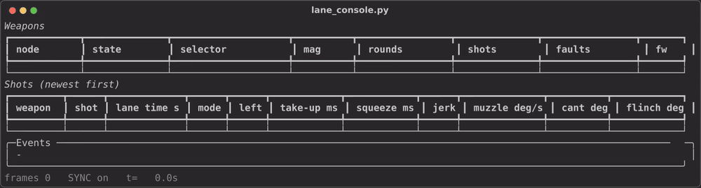
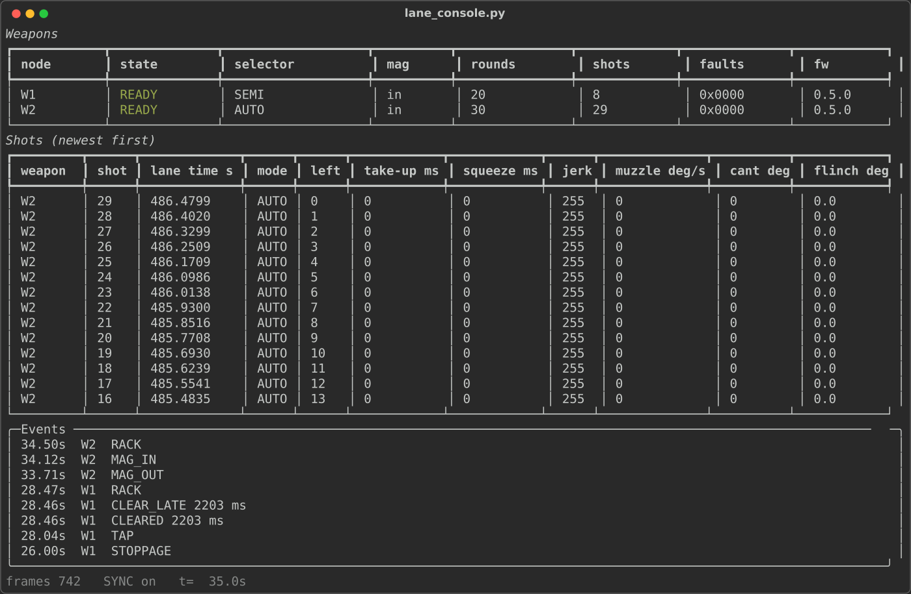
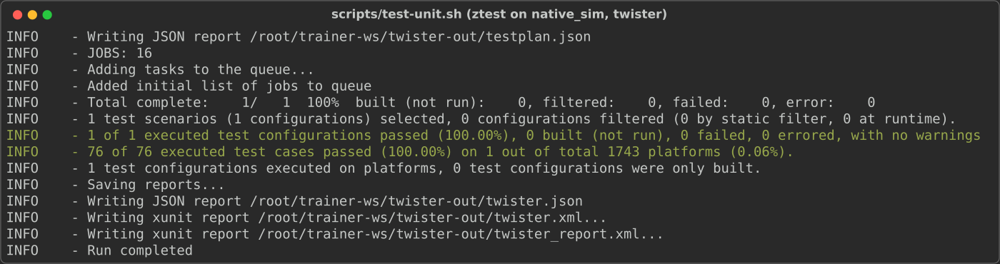
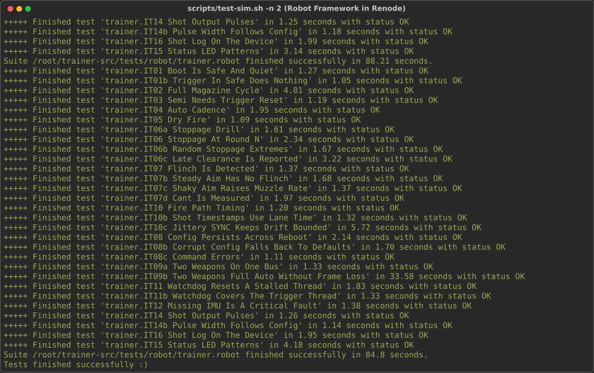

# Trainer-weapon firmware on a digital twin

[](https://github.com/chad416/trainer-weapon-firmware-twin/actions/workflows/ci.yml)

Zephyr RTOS firmware in C for an instrumented training weapon: analog trigger, safety selector, smart magazine, AUTO cadence, instructor-set stoppages, IMU aim metrics, and a CAN protocol defined in a DBC file. It runs on an emulated STM32H753 board (Antmicro's STM32H7 Renode Reference Platform) in the Renode simulator, so every requirement can be tested without hardware; a Python lane console talks to the emulated weapons over CAN. It is one part of a simulated training lane, with [motion-platform-controller](https://github.com/chad416/motion-platform-controller) and [aim-point-tracker](https://github.com/chad416/aim-point-tracker); in camera mode the weapon times its emitter flashes to the tracker's camera exposures.



*The lane console through a recorded two-weapon session (real output, 36 s, firmware v0.5.0). Video: [docs/media/lane_console.mp4](docs/media/lane_console.mp4) (GitHub does not play it on the file page; use Raw).*

The other two parts of the lane run live in the browser, compiled to WebAssembly: the camera side of this emitter in the [aim-point-tracker demo](https://chad416.github.io/aim-point-tracker/), and the [motion-platform-controller demo](https://chad416.github.io/motion-platform-controller/).

## Results (firmware v0.6.2)

| What | Result | Source |
|---|---|---|
| Unit tests (ztest, `native_sim`) | 81 of 81 pass | `scripts/test-unit.sh`, CI |
| Integration tests (Robot Framework in Renode) | 34 of 34 pass | `scripts/test-sim.sh`, CI |
| Fire path, virtual time | emitter on ≤ 1.5 ms after the trigger crosses break; SHOT_EVENT ≤ 2 ms | IT10 |
| Lane-time stamping | SHOT_EVENT = break sample time + SYNC offset, 0 µs error (limit 2 µs) | IT10b |
| Time-sync accuracy | ≤ 50 µs at ±200 ppm drift with 5 µs jitter, 100 ms ahead | unit `timesync` |
| AUTO cadence | 80 ± 1 ms at 750 rpm (±1.25 %) | IT04 |
| Camera-mode flashes | 500 µs wide (limit ±25 µs; one pulse in ten measured 488 µs in some runs); starts ≤ 35 µs from plan | IT17, IT17b, IT17d |
| Two weapons at 900 rpm | 10,000 shots each: complete in-order stream, 0 TX overflows, 0 TX errors (local run, 20 min) | IT09b, `STRESS_MAGS:100` |

Every requirement and its tests: [docs/traceability.md](docs/traceability.md). Specification and findings: [SPEC.md](SPEC.md). Changes: [CHANGELOG.md](CHANGELOG.md).

## Limits

- **No hardware yet.** Renode is functional, not cycle-accurate: the timing results prove ordering and scheduling in firmware time, not STM32H7 latencies.
- **Not fault-injected:** CAN bus-off and failed sends (Renode has no way to inject them), and the ADC, outputs, CAN, flash and watchdog BIT bits. The IMU fault path is tested (IT12).
- **Reset reason:** a Renode reset clears RAM and the RCC reset flags, so after a watchdog reset the simulated reason reads PIN; on silicon it would read TASK_WATCHDOG.
- **Time sync in Renode:** test frames arrive after a host-dependent delay, so absolute accuracy is proven in unit tests, not in the simulator.
- **Two-weapon test:** Renode allows one CAN tester per bus, so IT09b reads node 2's full stream and checks node 1 through its counters.
- **Partly covered:** F01 per-unit calibration, F11 STATUS rate, F14 BIT fault injection, R02, T02 measured separately ([traceability](docs/traceability.md)).
- **Demo motion** is scripted IMU data, not a recording of a real weapon. Coverage is not measured.

## Design in brief

```
 trigger pot ─► trigger thread (1 kHz ADC, hysteresis) ──┐
 SW1..SW4 ────► input callback ──────────────────────────┤ event queue; events carry
 AUTO cadence timer ─────────────────────────────────────┤ their sample time
                                                          ▼
              control thread: stoppage decision ─► weapon state machine (Zephyr SMF)
                 │ direct mode: emitter + valve pulses     camera mode: valve now,
                 │ SHOT_EVENT / SHOT_DETAIL / EVENT         shot frame ─► strobe thread ─► emitter
 IMU thread (208 Hz) ─► metrics at each shot
 lane thread: CMD service, SYNC fit, 10 Hz STATUS ─► CAN TX thread ─► FDCAN1 ─► lane bus
```

- **Task watchdog** on the control, trigger, IMU, CAN TX, lane and strobe threads, with the IWDG as fallback. Not watched: `main` (returns after start-up), the shell, the log thread and the system work queue (status LED).
- **Protocol:** [protocol/trainer.dbc](protocol/trainer.dbc), ID = (function << 7) | node. `protocol/gen_vectors.py` encodes sample messages with `cantools`, and the C encoders must match byte for byte (`--check` in CI).
- **Pure logic modules** (`trigger_proc`, `rounds`, `weapon_sm`, `malfunction`, `shotlog`, `proto`, `cfg`, `imu_metrics`, `timesync`, `strobe`) have no hardware calls and are unit-tested on `native_sim`.
- **Images:** `scripts/build.sh` builds the test image (`prj.conf` + `app/debug.conf`, with the `trainer stall` and `trainer cfg corrupt` shell commands the tests use). `TRAINER_IMAGE=field` builds `prj.conf` alone, without them.



*Lane console during the recorded session. Weapon 2 has fired a full-auto burst at 900 rpm; weapon 1's late stoppage clearance is flagged `CLEAR_LATE`.*

## Findings

- **Simulator clock:** Renode's STM32H7 clock model assumed an 8 MHz crystal, but this board has 25 MHz, so firmware time ran at 0.32× simulated time. `sim/trainer_board.repl` sets the crystal to 25 MHz (SPEC §13.1).
- **Time-sync robustness:** Renode's CAN delivery jitter pushed the drift fit to an absurd slope; the fit is bounded to ±500 ppm (§13.3).
- **Strobe pulse width:** relative kernel timeouts are rounded up by a tick, which made 0.5 ms flashes 0.56–0.61 ms; both edges are now switched on absolute tick edges in the timer interrupt (§13.6).
- **Review fixes in v0.6.2:** shots are stamped with the break sample time, BIT no longer races the IMU thread, the emitter gate has one owner per mode, failed CAN sends are counted in STATUS (§13.7).

## Quick start (Ubuntu 24.04 or WSL2)

The versions are the ones CI uses: Zephyr pinned in `west.yml` (4.4.99, `c605ea46`), Zephyr SDK 1.0.1, Renode 1.17.0, Python 3.12.

```bash
# System packages
sudo apt-get install -y --no-install-recommends git cmake ninja-build gperf ccache \
  dfu-util device-tree-compiler wget python3-dev python3-venv xz-utils file make \
  gcc gcc-multilib g++-multilib libsdl2-dev libmagic1

# West workspace: this repository is the manifest repository, checked out as trainer-fw
mkdir -p ~/trainer-ws && cd ~/trainer-ws
git clone https://github.com/chad416/trainer-weapon-firmware-twin.git trainer-fw
python3 -m venv ~/zvenv && source ~/zvenv/bin/activate
pip install -r trainer-fw/requirements.txt
west init -l trainer-fw
west update -n -o=--depth=1
west packages pip --install
west sdk install -t arm-zephyr-eabi

# Renode 1.17.0 and its Robot Framework requirements
mkdir -p ~/renode
wget -qO- https://github.com/renode/renode/releases/download/v1.17.0/renode-1.17.0.linux-portable.tar.gz \
  | tar -xz -C ~/renode --strip-components=1
export PATH="$HOME/renode:$PATH"
pip install -r ~/renode/tests/requirements.txt

# Build and test
cd ~/trainer-ws/trainer-fw
bash scripts/build.sh        # test image -> ~/trainer-ws/build/app
bash scripts/test-unit.sh    # unit tests (twister)
bash scripts/test-sim.sh     # integration tests in Renode, about 2 minutes
```

The scripts read `TRAINER_WS` (default `~/trainer-ws`), `TRAINER_VENV` (default `~/zvenv`) and `TRAINER_BUILD` (default `$TRAINER_WS/build/app`); see `scripts/_env.sh`. Zephyr's tools break on paths that contain a space: if the checkout path has one (a Windows folder seen from WSL, say), the scripts bind-mount it at `~/trainer-src`, which needs root. Cloning to a path without spaces avoids that.

The full stress run (about 20 minutes): `bash scripts/test-sim.sh --include stress --variable STRESS_MAGS:100`.

### Lane console on the live simulation

Needs `pip install -r requirements-demo.txt`, and for the recorded demo `can-utils`, `ffmpeg` and `librsvg2-bin`. `sim/lane_live.resc` bridges the emulated CAN bus to the host's SocketCAN `vcan0`; `scripts/demo.sh` (as root, for `vcan`) runs the scripted two-weapon session and writes `docs/session` and `docs/media`. By hand:

```bash
python3 tools/lane/lane_console.py --log session.csv   # live view; sends SYNC every 10 ms
python3 tools/lane/lane_cmd.py 2 set auto_rpm 900       # one command, prints the ACK
python3 tools/lane/lane_cmd.py 1 inject                 # instructor stoppage
python3 tools/lane/session_report.py session.csv --out report/
```

<p>


</p>

*Captured unit and integration test runs from v0.5.0 (before camera mode); the current counts are in the results table.*

## Layout

```
app/            Zephyr application: src/, board overlay, Kconfig, prj.conf, debug.conf (test image)
protocol/       trainer.dbc (CAN protocol), test vectors and their generator
tests/unit/     ztest suites for the pure logic modules
tests/robot/    Renode Robot Framework integration tests
sim/            Renode platform (.repl) and scripts: single, lane, lane_live (SocketCAN bridge)
sim/data/       IMU recordings (RESD) and their generator
tools/lane/     lane console, command tool, session report, demo scenario, media helpers
docs/           traceability, recorded session report, screenshots and video
scripts/        build, test and demo helpers
.github/        CI: lint, vector check, builds, unit tests, Renode tests, report artifacts
west.yml        pins Zephyr to the reference platform's revision
```

## License

MIT ([LICENSE](LICENSE)). `sim/trainer_board.repl` contains Antmicro's board description from the Zephyr tree and keeps its Apache-2.0 license; the changes are marked in the file ([NOTICE](NOTICE)).
