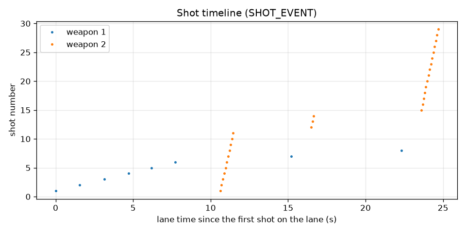
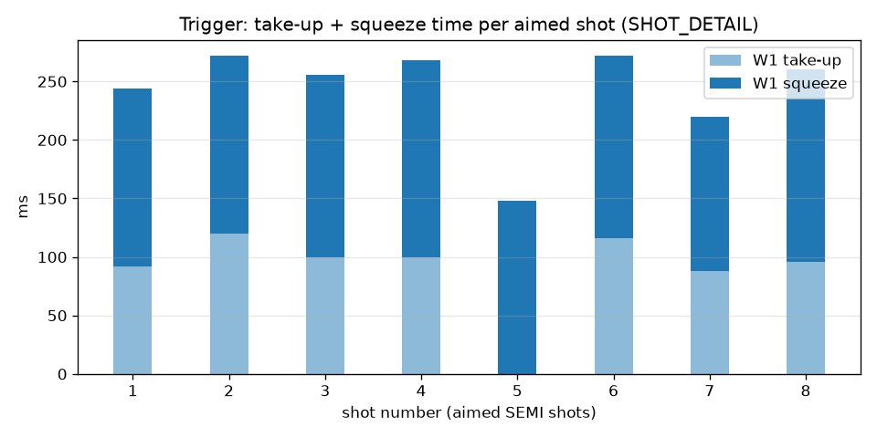
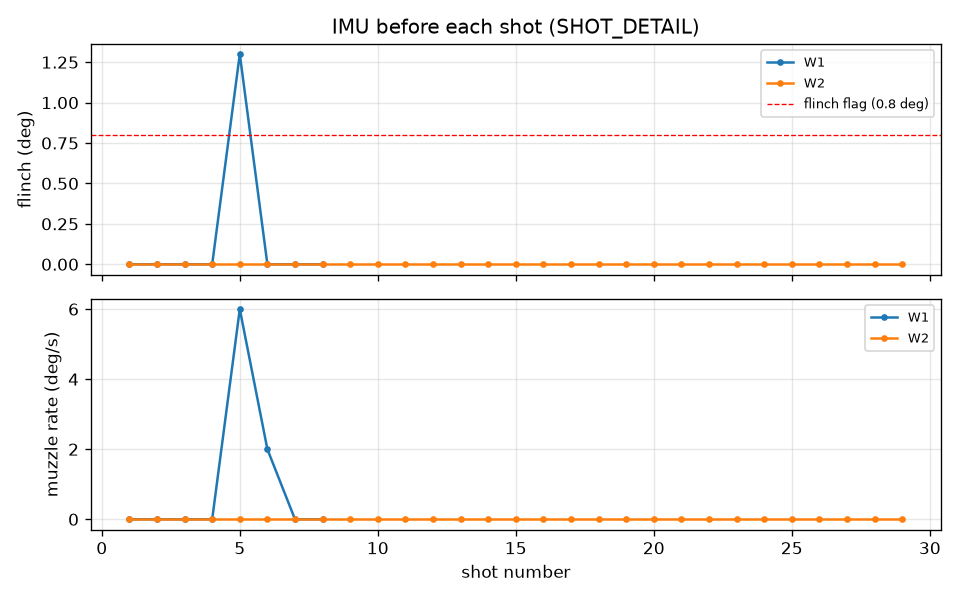

# Session summary

Source: `session.csv`

| weapon | shots | aimed (SEMI) | flinch >= 0.8 deg |
|---|---|---|---|
| W1 | 8 | 8 | 1 |
| W2 | 29 | 0 | 0 |

- Stoppages: 3, dry fires: 0
- Clearance times (ms): W1 2201, W2 1893, W1 2203
- Late clearances: W1 2203 ms

